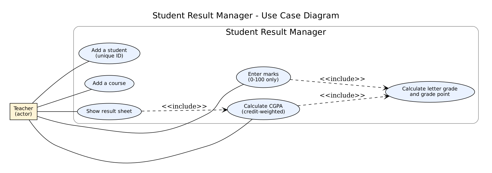
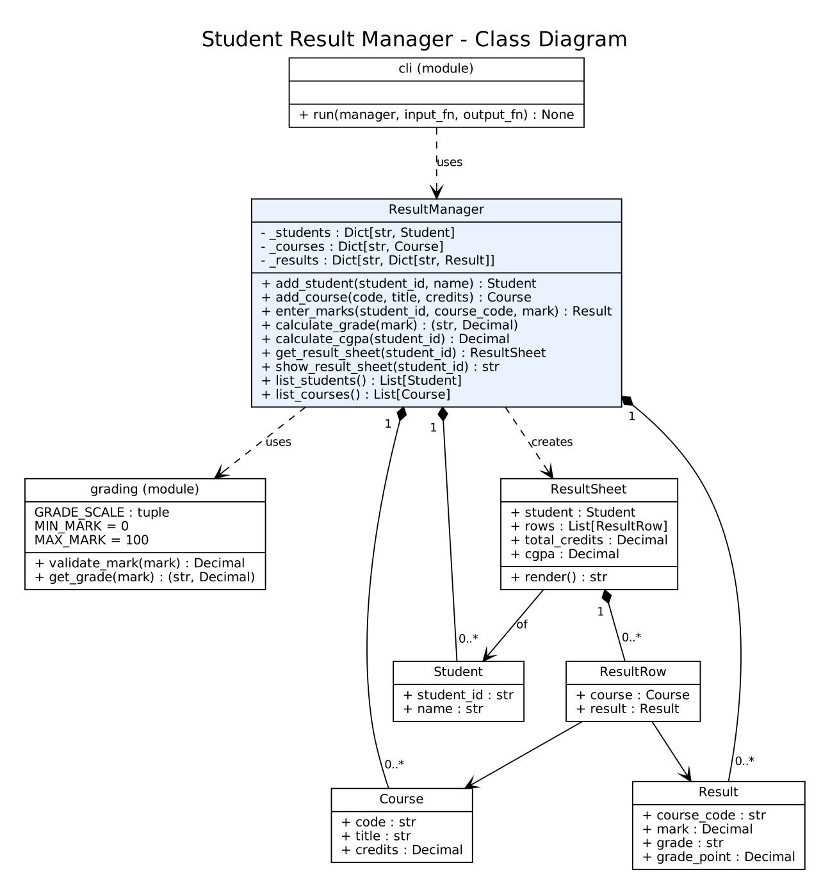
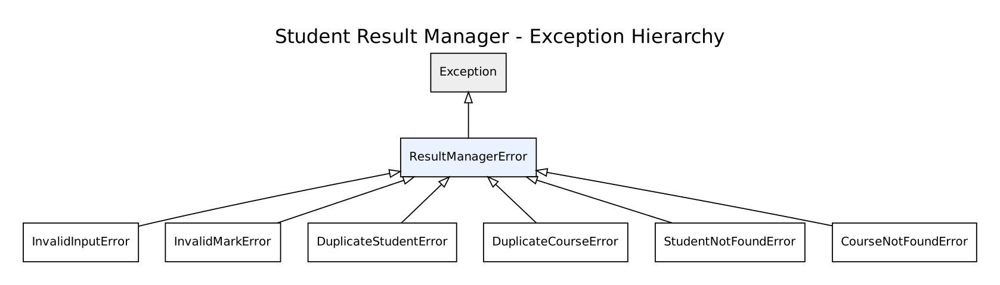
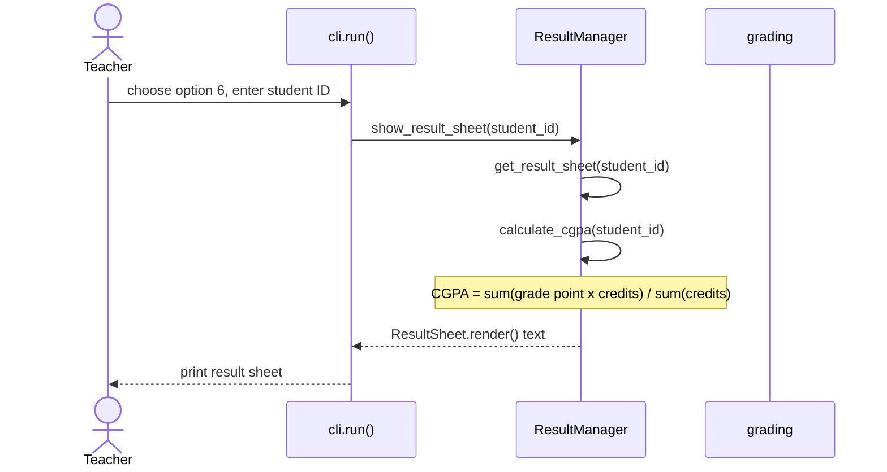
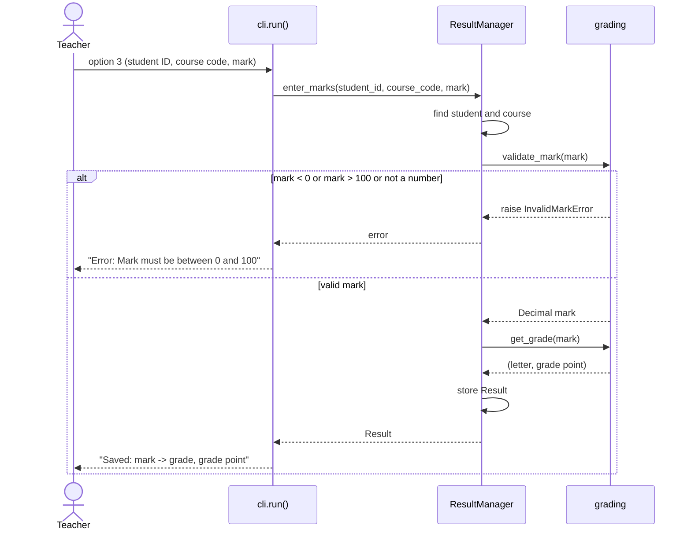

# UML Diagrams - Student Result Manager

PNG versions (made from the `.dot` files in this folder):

| Diagram | File |
|---|---|
| Use case diagram | [use_case_diagram.png](use_case_diagram.png) |
| Class diagram | [class_diagram.png](class_diagram.png) |
| Exception hierarchy | [exceptions_diagram.png](exceptions_diagram.png) |

## Sequence diagram - "Show a student's result sheet" (GitHub renders this)

## Sequence diagram - "Enter marks"

